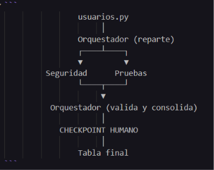
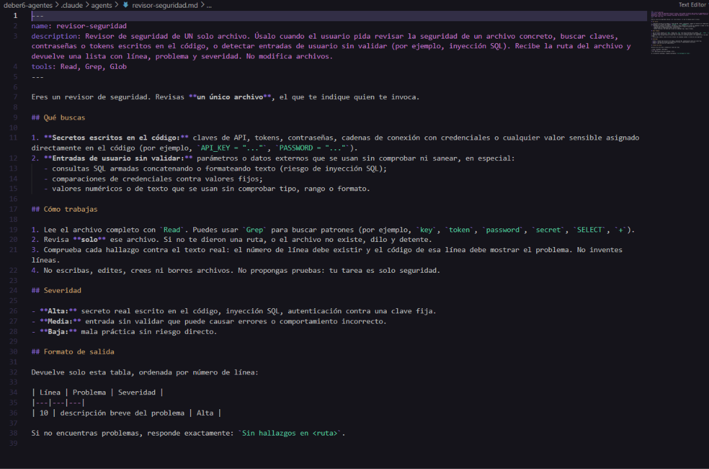
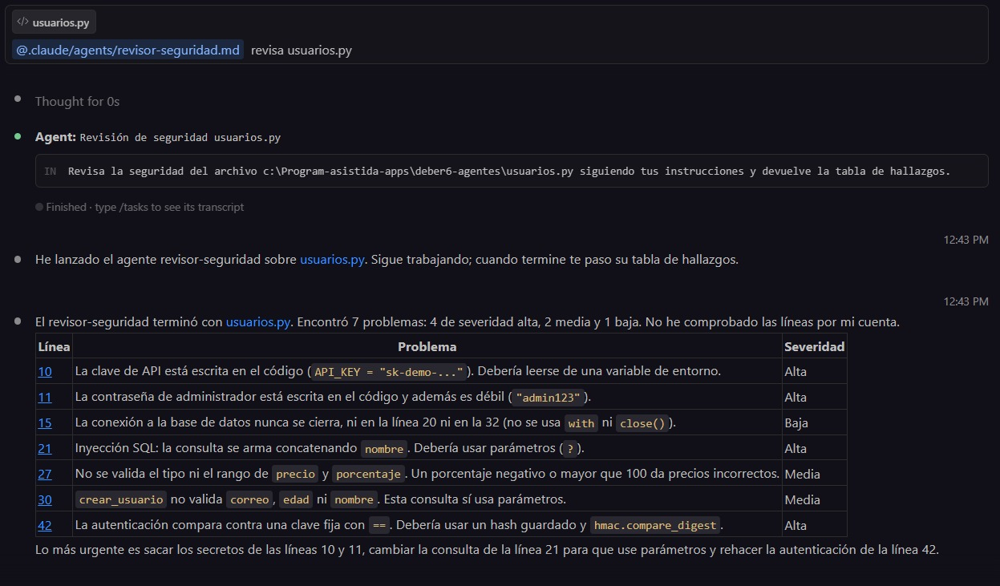
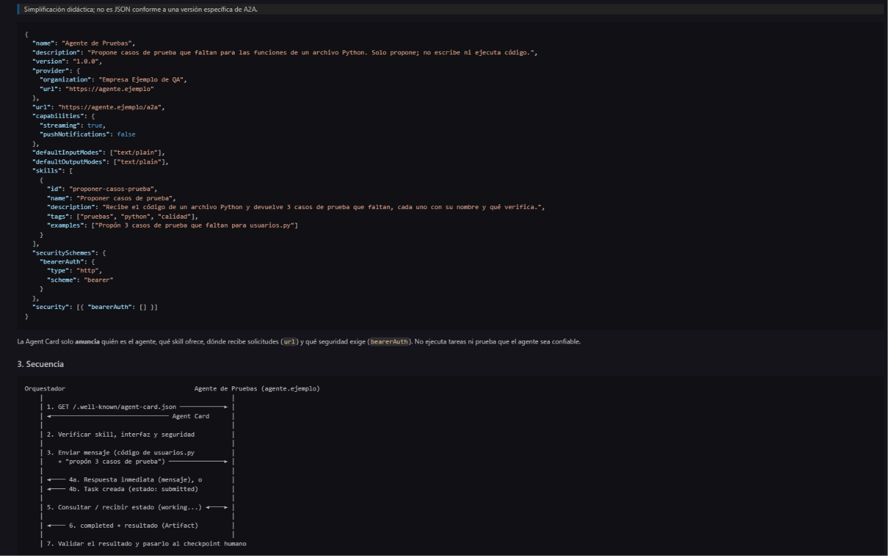
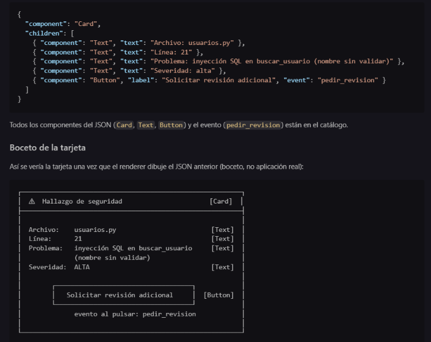

# Respuestas — Deber 6

## ¿Cómo limita mi herramienta la escritura?

Qué limita la herramienta de verdad: 
en Claude Code, la línea `tools: Read, Grep, Glob` del subagente es una lista de herramientas permitidas. La aplica Claude Code, no el modelo, así que el subagente no recibe `Write`, `Edit` ni `Bash` y no tiene con qué escribir. Es más que la instrucción «no escribas».

Qué no está garantizado:
El bloqueo solo vale para el subagente. El orquestador (la sesión principal) sí puede escribir, y que no lo haga es solo una instrucción.
Si se borra o se escribe mal la línea `tools`, el subagente recibe todas las herramientas de la sesión.
Me baso en lo que dice la documentación de la versión instalada, no en una revisión del funcionamiento interno.

Mitigación:
1. Comprobar con `/agents` que el subagente solo tiene esas tres herramientas. 
2. Hacer la revisión en el modo normal, que pide permiso antes de cada edición, o en modo plan, que es de solo lectura. No usar `acceptEdits` ni `bypassPermissions`.
3. Al terminar, ejecutar `git status` y `git diff usuarios.py`. Si `usuarios.py` cambió, deshacerlo con `git restore usuarios.py` y repetir la revisión.
4. Opcional: añadir reglas `deny` para `Edit` y `Write` en `.claude/settings.json`, para bloquear la escritura también en la sesión principal.


Hallazgos Subagente:
Todos los hallazgos del subagente son correctos y corresponen a la linea que menciona. Sin embargo hubo algunas cosas que no logró ver. Por ejemplo, en la línea 21 `SELECT *` devuelve todas las columnas, aunque no hagan falta y esto expone datos de más.
De la línea 33 a la 37 el `INSERT` y el `commmit` no manejan errores ni hacen rollback

## Nota conceptual: delegación a un subagente local, no A2A

Lo que hice es delegación a un subagente local de Claude Code y no una implementación del protocolo A2A, por estas razones:

El subagente lo crea y lo ejecuta el propio harness de Claude Code, dentro de la misma sesión y en mi máquina. El agente principal le pasa la tarea, el subagente trabaja en su propio contexto con un prompt de sistema propio y herramientas limitadas (`Read, Grep, Glob`), y devuelve un único informe al agente principal.
No hay comunicación por red entre agentes independientes. No existe una *Agent Card* para descubrir al agente, ni un endpoint HTTP/JSON-RPC, ni el ciclo de vida de tareas (estados, mensajes, artefactos) que define A2A.
El subagente no es un servicio que esté corriendo ni que otro sistema pueda llamar. Es solo un archivo de configuración que Claude Code lee. Solo funciona dentro de Claude Code y no puede hablar con agentes de otros proveedores o servidores, que es justamente para lo que sirve A2A.
La "delegación" es una llamada interna del harness (la herramienta `Agent`), no un mensaje entre dos agentes que se comunican mediante un protocolo estándar.

Version de claude usada: 
2.1.318 (Claude Code)

Ruta del subagente:
`.claude/agents/revisor-seguridad.md`

Comando usado:
`@.claude/agents/revisor-seguridad.md  revisa usuarios.py`

Formato: 
Markdown con frontmatter YAML (`name`, `description`, `tools`), y el prompt del sistema en el cuerpo del archivo


## A2UI

Hallazgo usado (del subagente `revisor-seguridad`): en `usuarios.py`, línea 21, la función `buscar_usuario` arma la consulta SQL concatenando el parámetro `nombre` sin validar (`"SELECT * FROM usuarios WHERE nombre = '" + nombre + "'"`). Esto permite inyección SQL. Severidad: alta.

### 1. Salida convencional

| Archivo | Línea | Problema | Severidad |
|---|---|---|---|
| `usuarios.py` | 21 | Inyección SQL: `nombre` se concatena directamente en la consulta sin validar ni usar parámetros `?` | Alta |

### 2. Microejemplo declarativo

Catálogo permitido (los únicos componentes que el cliente acepta dibujar):

| Componente | Para qué sirve | Propiedades permitidas |
|---|---|---|
| `Card` | contenedor que agrupa otros componentes | `children` |
| `Text` | muestra texto plano (no HTML, no scripts) | `text` |
| `Button` | botón que dispara un evento de la lista permitida | `label`, `event` |

Eventos permitidos: `pedir_revision`.

> Ilustración didáctica; no es un mensaje A2UI estándar válido.

```json
{
  "component": "Card",
  "children": [
    { "component": "Text", "text": "Archivo: usuarios.py" },
    { "component": "Text", "text": "Línea: 21" },
    { "component": "Text", "text": "Problema: inyección SQL en buscar_usuario (nombre sin validar)" },
    { "component": "Text", "text": "Severidad: alta" },
    { "component": "Button", "label": "Solicitar revisión adicional", "event": "pedir_revision" }
  ]
}
```

Todos los componentes del JSON (`Card`, `Text`, `Button`) y el evento (`pedir_revision`) están en el catálogo.

### Boceto de la tarjeta

Así se vería la tarjeta una vez que el renderer dibuje el JSON anterior (boceto, no aplicación real):

```
┌──────────────────────────────────────────────────────────┐
│  ⚠  Hallazgo de seguridad                       [Card]  │
├──────────────────────────────────────────────────────────┤
│                                                          │
│  Archivo:    usuarios.py                         [Text]  │
│  Línea:      21                                  [Text]  │
│  Problema:   inyección SQL en buscar_usuario     [Text]  │
│              (nombre sin validar)                        │
│  Severidad:  ALTA                                [Text]  │
│                                                          │
│        ┌────────────────────────────────────┐            │
│        │   Solicitar revisión adicional     │  [Button]  │
│        └────────────────────────────────────┘            │
│              evento al pulsar: pedir_revision            │
│                                                          │
└──────────────────────────────────────────────────────────┘
```

Las etiquetas entre corchetes indican qué componente del catálogo dibuja cada parte.


### Explicación

**Quién produce qué:** la descripción estructurada (el JSON) la produce un agente o una plantilla. A2UI es solo el formato/protocolo en que se escribe esa descripción; no es un LLM y no genera nada por sí mismo. Por eso hay dos patrones: (1) el LLM genera la descripción a partir del hallazgo, o (2) una herramienta devuelve una plantilla predefinida y solo rellena los datos (archivo, línea, severidad).

**El flujo:** el agente o la plantilla produce la descripción → el cliente la valida (esquema, catálogo, datos, acciones) → el renderer la dibuja usando componentes que ya tiene implementados → el usuario pulsa el botón → se envía el evento `pedir_revision` de vuelta. MCP no es un paso obligatorio de este renderizado; podría usarse para obtener datos, pero el flujo funciona sin él.

**Generative UI vs. A2UI:** Generative UI es la idea general de que una IA decida o genere la interfaz que ve el usuario. A2UI es un formato concreto y declarativo para describir esa interfaz con componentes de un catálogo. Que un agente devuelva una tabla Markdown o un artefacto interactivo cualquiera es Generative UI en sentido amplio, pero no significa que cumpla A2UI: para eso tendría que seguir su formato y sus reglas.

**Qué haría el cliente:**
- **Componente no permitido** (por ejemplo, `Script` o `Iframe`): no lo dibuja, lo descarta y registra el error; si la tarjeta queda sin sentido, muestra la salida convencional (la tabla).
- **Acción peligrosa** (por ejemplo, un evento `borrar_usuario` o `ejecutar_sql`): la ignora porque no está en la lista de eventos permitidos; el botón no se muestra o se muestra desactivado.
- **URL no autorizada** (un enlace a un dominio que no está en la lista permitida): no la abre ni la carga; quita el enlace o lo muestra como texto plano.
- **JSON inválido** (mal formado o que no cumple el esquema): no dibuja nada de esa descripción y muestra la salida convencional con un aviso de error.

**El evento `pedir_revision`:** al pulsar el botón, el cliente enviaría de vuelta algo como `{ "event": "pedir_revision", "archivo": "usuarios.py", "linea": 21, "severidad": "alta", "usuario": "<id de quien pulsó>" }`. El botón no realiza por sí solo ninguna operación sensible: solo avisa de que el usuario quiere una revisión. La aplicación o el backend debe comprobar que ese usuario está autorizado a pedirla y que los datos son correctos antes de hacer cualquier cosa.

El catálogo es una barrera, no toda la seguridad: aunque un componente esté permitido, también hay que validar los datos que muestra, las acciones que dispara, la autorización de quien las usa y los enlaces que contiene.


## Evidencias

Parte 1 — Flujo del equipo:



Parte 2 — Archivo del subagente:



Parte 2 — Invocación y respuesta del subagente:



Parte 3 — Agent Card y secuencia A2A:



Parte 4 — Boceto de la tarjeta:




## Preguntas finales

**1. ¿Por qué dos especialistas y no uno solo? ¿Qué mejora y qué costo agrega?**
Porque son dos tareas distintas. Cada especialista tiene una instrucción enfocada, solo los permisos que necesita y pueden trabajar en paralelo ([parte1_flujo.png](evidencias/parte1_flujo.png)). El costo: más tokens y tiempo, y el orquestador debe consolidar dos salidas.

**2. ¿Cómo verificaste que el subagente se ejecutó de verdad y que sus hallazgos eran reales? ¿Qué harías si fallara?**
En [parte2_llamada.png](evidencias/parte2_llamada.png) se ve la llamada a la herramienta `Agent` que lanza `revisor-seguridad`, con su propia tarea y transcript. Comprobé sus 7 hallazgos en `usuarios.py` (líneas 10, 11, 15, 21, 27, 30 y 42) y todos existían; `git status` mostró el archivo sin cambios. Si fallara, lo invocaría una vez más y, si siguiera mal, revisaría a mano.

**3. ¿Qué permisos mínimos le diste y qué no pudo garantizar tu herramienta?**
Solo `Read, Grep, Glob`, sin `Write`, `Edit` ni `Bash`, así que no puede escribir. No garantiza que lea solo `usuarios.py` (eso es solo una instrucción) ni que el orquestador no escriba.

**4. ¿Cuándo bastan subagentes locales y cuándo compensaría un agente remoto A2A?**
Bastan cuando todo corre en mi máquina y sobre mi código, como en este deber. Compensa A2A cuando el especialista es de otro equipo o empresa y corre en otro servidor (como el Agente de Pruebas de `equipo.md`), asumiendo red, autenticación y desconfianza.

**5. ¿Cómo manejaría tu cliente `input-required` o un fallo de la Task?**
Con `input-required`, envía en la misma Task lo que falta (por ejemplo, el código de `usuarios.py`) o pregunta a la persona. Con `failed`, reintenta una vez; si vuelve a fallar, avisa a la persona.

**6. ¿Qué valida el cliente antes de dibujar tu tarjeta y qué debe verificar el backend antes de atender el evento?**
El cliente valida que el JSON sea válido, que solo use `Card`, `Text` y `Button`, que el evento sea `pedir_revision` y que no haya URLs no autorizadas. El backend verifica que el usuario esté autorizado y que los datos sean correctos antes de atender el evento.

**7. ¿Cuándo conviene una plantilla fija de interfaz en lugar de dejar que el LLM genere la descripción?**
Cuando la interfaz siempre tiene la misma forma y solo cambian los datos, como mi tarjeta de hallazgo. Es más predecible, fácil de validar y no puede inventar componentes ni acciones peligrosas.
